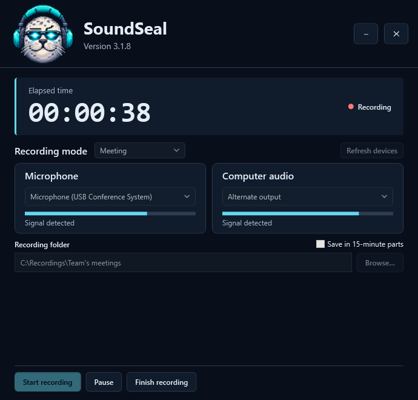
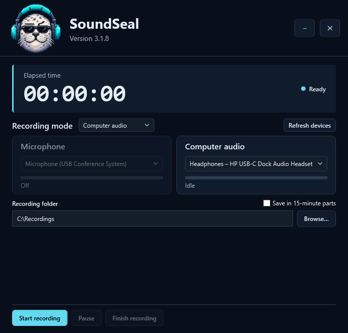
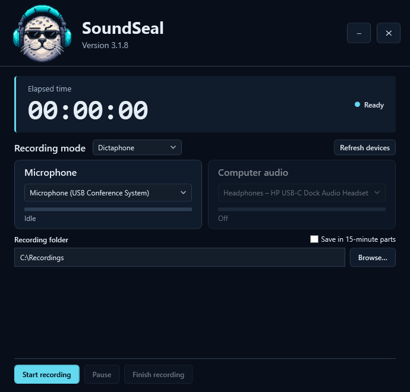
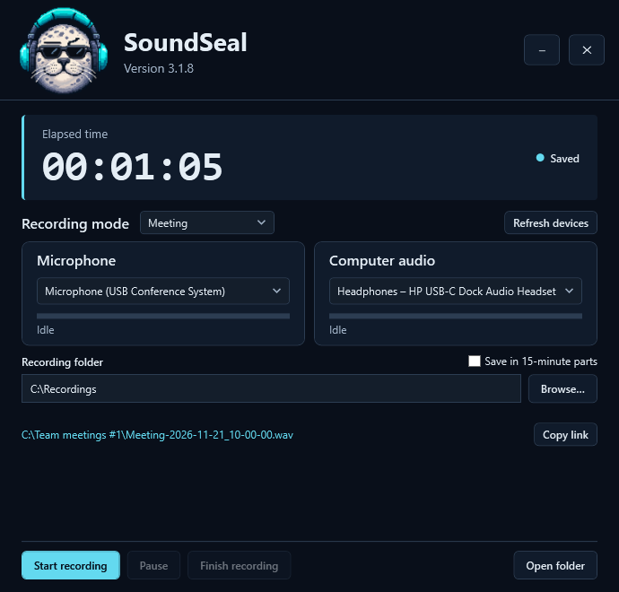
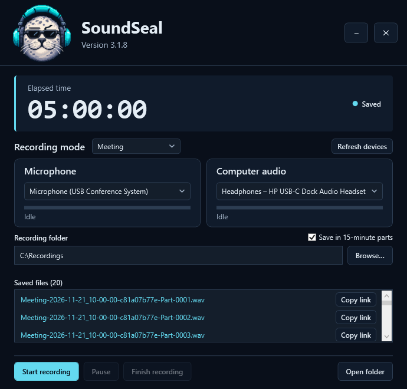

# SoundSeal


SoundSeal is a simple offline Windows recorder for meetings, audio streams and voice notes. It saves standard WAV files on your computer so you can pass them to an AI tool of your choice for transcription and summarization. You choose the tool and upload the files yourself.

| Recording mode | Captures | Example |
| --- | --- | --- |
| Meeting | Your microphone and the selected playback device, mixed into one mono track | Both sides of an online meeting |
| Computer audio | The selected playback device through Windows loopback | A webinar or audio stream |
| Dictaphone | Your selected microphone | A voice memo or dictated notes |

## Screenshots

| Choose audio sources | Record a meeting |
| --- | --- |
| [](docs/screenshots/ready.png) | [](docs/screenshots/recording.png) |

<details>
<summary>Computer audio — playback only</summary>



</details>

<details>
<summary>Dictaphone — microphone only</summary>



</details>

<details>
<summary>Saved recording</summary>



</details>

<details>
<summary>Recording saved in 15-minute parts</summary>



</details>

## Build and run

Install the **.NET 10 SDK for x64** and run these commands in PowerShell from the repository root. The first restore requires access to NuGet or a local cache containing the required packages.

```powershell
dotnet restore .\src\MeetingRecorder.slnx
dotnet build .\src\MeetingRecorder.slnx -c Release --no-restore
dotnet test .\src\MeetingRecorder.slnx -c Release --no-build
dotnet run --project .\src\MeetingRecorder\MeetingRecorder.csproj -c Release --no-build
```

After building, you can launch `src\MeetingRecorder\bin\Release\net10.0-windows\SoundSeal.exe` directly. To run the build on another computer, copy the entire output directory and install the **.NET 10 Desktop Runtime for x64** there.

## Make a recording

1. Choose **Meeting** for microphone and playback, **Computer audio** for playback only, or **Dictaphone** for microphone only. SoundSeal opens only the devices needed for that mode. Filenames begin with `Meeting-`, `Audio-` or `Dictaphone-`.
   Choose the microphone or playback device required for your mode. For a meeting, select the headphones or speakers you use to hear the other participants. SoundSeal initially selects the Windows defaults and keeps your selected devices for the entire recording, including pauses.
2. Check **Recording folder**. The default is `%LOCALAPPDATA%\MeetingRecorder\Recordings`. Enter a path or click **Browse…** to choose a folder. SoundSeal creates the folder when recording starts if it doesn't already exist.
3. Click **Start recording**. The seal's glasses glow while recording is active, and a red dot appears beside **Recording**. Speak into the microphone, then check the other meter when someone on the call speaks. Each meter shows **Signal detected** or **Silent**. **Elapsed time** keeps counting during silence.
4. Click **Pause** to leave a break out of the file. Both meters show **Paused** and the timer stops. Click **Resume** to continue recording to the same file.
5. Click **Finish recording**. When the status changes to **Saved**, the window shows the duration and full file path. Click **Copy link** beside the path to copy a `file://` link to the WAV, or **Open folder** to find it in File Explorer. Anyone using the link needs access to the same file location. If you close the window during a recording, choose **Finish and exit** to save it or **Return to recorder** to keep the session open.

Enable **Save in 15-minute parts** before starting a long recording to publish an independent WAV after every 15 minutes of captured audio. All modes support this option. Pauses stop the part clock. Finishing saves the remaining audio, and the result list shows the parts in order with a **Copy link** action on each row. Files in one session share a name prefix and use suffixes such as `Part-0001.wav` and `Part-0002.wav`.

Completed parts can be opened while recording continues. SoundSeal writes and flushes each WAV header and closes the file before publishing the final name. After an abrupt shutdown, completed parts remain in the recording folder. The open part can remain as a `.partial` file. Leave the option off to publish a single WAV at the end.

SoundSeal saves one mono track as 16-bit PCM audio at 16,000 Hz. One hour of active recording uses about 115.2 MB. Filenames include the start time, for example `Meeting-2026-11-21_14-35-08.wav`. If a name is already in use, SoundSeal adds a numeric suffix.

## Transcribe and summarize

Click **Open folder** and select the WAV in your transcription tool. For a split recording, submit the files in part-number order, then ask the AI to summarize the combined transcript. For a meeting, you can ask it to list decisions, action items and open questions. **Copy link** copies a local file URI suitable for an application with access to that folder. Use the WAV upload option for a web service.

## Troubleshooting

When reporting a recording issue, include the version shown below **SoundSeal** in the window header and the names of the selected devices.

| What you see or hear | What to check |
| --- | --- |
| **Microphone** stays **Silent** while you speak | Check the selected input, the microphone's hardware mute switch, and the Windows input level. In Windows microphone privacy settings, allow desktop apps to access the microphone. |
| **Computer audio** stays **Silent** while someone else speaks | Check that the calling app uses the playback device selected in SoundSeal. WASAPI loopback captures the shared mix on that device, including browser audio and notifications. Protected content and apps using exclusive mode may be unavailable for capture. |
| Recording stops immediately with a device discontinuity when a Bluetooth call starts | Use SoundSeal 3.1.7 or later. During a call, a Sony WH-1000XM5 can flag a microphone packet after a brief gap. SoundSeal resumes at the next reliable timestamp and leaves silence in the missing portion of that source. It also handles the headset’s 48 kHz playback samples and 16 kHz device counter. |
| A device is missing or busy | Connect the device or close the app using it in exclusive mode, then click **Refresh devices**. |
| You hear the other participant twice in the recording | Sound from the speakers can reach the microphone. A headset reduces this echo. |
| **Error** appears after a device disconnects or the recorder is overloaded | Read the message below **Recording folder**. If SoundSeal saved part of the recording, the message shows the WAV file path. Check the devices before clicking **Start recording** again. |
| A disk error occurs or SoundSeal cannot finish writing the file | Check free disk space and write access to the folder. If SoundSeal kept an unfinished file, the window shows its `.wav.partial` path. It may contain audio data with an incomplete WAV header. |

## Testing

We tested **Google Meet** on Windows with a **Sony WH-1000XM5** Bluetooth headset. The microphone sometimes flagged consecutive packets as discontinuous even when their positions and timestamps kept advancing. With those flags, version 3.1.5 stopped in four ordinary starts. Version 3.1.7 saved both ordinary test recordings and five more with a deliberate 135 ms delay in the capture thread. We used the headset’s actual packet timing and substituted two synthetic tones for the call audio to verify the saved WAV files.

Unit tests exercise individual components. Integration tests exercise capture queues, the file system, dependency injection, and the WPF window. To run either category from the repository root, use the corresponding command.

```powershell
dotnet test .\src\MeetingRecorder.slnx -c Release --filter Category=Unit
dotnet test .\src\MeetingRecorder.slnx -c Release --filter Category=Integration
```

For line and branch coverage, run `./scripts/Test-Coverage.ps1` in PowerShell 7. The script runs the full suite in Release, merges Coverlet results from all four test projects, and reports coverage for each application module. It saves the raw JSON reports in a separate directory under `TestResults`.

The same Release coverage script was run on each revision. Percentages combine lines and branches across test hosts, counting each location once. The contracts assembly consists of interfaces and has no executable lines.

| Revision | Tests passed | Lines covered | Branches covered |
| --- | ---: | ---: | ---: |
| v1.3.0 | 104 | 887 / 1030 (86.1%) | 480 / 535 (89.7%) |
| v2.0.0 | 141 | 1258 / 1410 (89.2%) | 593 / 646 (91.8%) |
| v3.1.0 | 154 | 1393 / 1546 (90.1%) | 721 / 776 (92.9%) |
| v3.1.3 | 154 | 1395 / 1548 (90.1%) | 731 / 786 (93.0%) |
| v3.1.5 | 159 | 1401 / 1554 (90.2%) | 733 / 788 (93.0%) |
| v3.1.7 | 166 | 1404 / 1557 (90.2%) | 739 / 794 (93.1%) |
| v3.1.8 | 166 | 1406 / 1559 (90.2%) | 740 / 795 (93.1%) |

The v2.0.0 domain suite and integration tests together exercise all 227 executable domain lines and all 96 domain branches. The full suite covers invalid value construction, immutable device and folder listings, cancellation before and during device startup, retry after cleanup, and publication after late cancellation.

The four test projects cover recorder states, timing, the WPF window, mixing synthetic audio sources, and the contents of saved WAV files. The clock-drift tests simulate 44.1 kHz and 48 kHz devices with 100 ppm of relative drift over an hour. Once the dependencies are restored, the tests can run offline without a sound card.

To check real hardware, record both sides of a call, try a different playback device, pause and resume, then listen to the result. In a separate short recording, disconnect the selected headset and play the saved segment. For an hour-long call, check the start and end of the audio and compare the WAV duration with the recorder's timer. You can also repeat a short recording offline.

## Architecture

SoundSeal follows the layer boundaries and build conventions used in DayScope at commit `c9d9845`. The WPF application is the composition root. The table lists direct dependencies on other projects in the solution.

| Project | Responsibility | Project dependencies |
| --- | --- | --- |
| `MeetingRecorder.Domain` | Recording values, timeline, state, device selections and publication outcomes | None |
| `MeetingRecorder.Abstractions` | Recorder, capture session, clock, device catalog, PCM sink, recording store, folder and display timer contracts | Domain |
| `MeetingRecorder.Application` | Serializes start, pause, resume and finish, reconciles capture failures with the final file outcome | Abstractions, Domain |
| `MeetingRecorder.Infrastructure` | Negotiates WASAPI formats, owns native buffers, aligns device clocks, resamples and mixes the two sources | Abstractions, Domain |
| `MeetingRecorder.Storage` | Reserves temporary files, writes and publishes WAV files, enumerates folders and opens File Explorer | Abstractions, Domain |
| `MeetingRecorder` | WPF window, view models, clipboard, dispatcher timer and dependency injection | All five libraries |

The native buffer and endpoint interfaces live beside the WASAPI adapter because their signatures use native flags and audio packets. The mixer writes to `IPcmSink`. Its unit tests inspect samples in memory, while integration tests reopen WAV files and check headers, payloads, pause boundaries and partial-file recovery.

### Domain contracts

| Value | Enforced at construction |
| --- | --- |
| `CaptureTimestamp`, `ActiveInterval`, `RecordingDuration` | Capture time uses nonnegative 100 ns ticks. The exclusive end can equal or follow the start. Active time excludes pauses. |
| `FrameCount`, `Pcm16Block` | A nonnegative frame count must fit a recording duration. Each PCM16 block contains a whole number of two-byte samples. |
| `SignalPeak` | Both input meters accept finite values from zero through one, inclusive. |
| `EndpointId`, `EndpointName`, `RecordingProblem` | Device identifiers, display names and failure messages contain visible text. |
| `RecordingFolder`, `RecordingFile`, `FolderEntryName` | Recording paths are fully qualified. Files require a final name. A chooser entry is a single directory name or a drive root. Constructing these values requires no filesystem access. |
| `RecorderSnapshot`, `RecordingResult` | Only recording snapshots have an open interval. Terminal states carry a matching outcome. Publication requires a file, and a failed publication with a retained file or written frames requires a problem description. |

### Capture configuration

Edit the `AudioCapture` section in `appsettings.json` beside `SoundSeal.exe` and restart the application. Configuration is validated when the host builds. These limits apply to incoming device formats. Output remains 16 kHz mono PCM16.

| Key | Default | Meaning |
| --- | --- | --- |
| `MinimumSampleRate` / `MaximumSampleRate` | 8000 / 384000 | Inclusive native rates in Hz. Both must be positive and ordered. |
| `MaximumChannels` | 32 | Maximum native channel count, from 1 to the 32 positions in a Windows speaker mask. |
| `AllowedEncodings` | `Pcm8,Pcm16,Pcm24,Pcm32,Float32,Float64` | Comma-separated subset of implemented little-endian decoders. |
| `QueueCapacity` | 512 | Positive limit on pending capture messages. A full queue interrupts capture and publishes the available audio. |

### Lifetimes and cancellation

The user starts and stops each capture interval. Its single native thread acquires and releases WASAPI buffers on the same thread. An asynchronous channel reader mixes owned copies and feeds the destination. The WPF dispatcher timer only refreshes the display. A host-lifetime background service would outlive these recording intervals. [WASAPI buffer ownership](https://learn.microsoft.com/en-us/windows/win32/api/audioclient/nf-audioclient-iaudiocaptureclient-getbuffer) · [WPF threading model](https://learn.microsoft.com/en-us/dotnet/desktop/wpf/advanced/threading-model) · [.NET worker services](https://learn.microsoft.com/en-us/dotnet/core/extensions/workers)

Asynchronous service methods require a `CancellationToken`. Device discovery, navigation, pending commands and interval startup observe the caller's token. Canceling startup releases the endpoints and discards an empty reservation. If any samples were captured, the writer attempts to publish them. Once the recorder accepts a pause or finish, a session-owned token lets it drain accepted samples and finish the WAV header even if the originating UI command is canceled. Each asynchronous xUnit test runs with its own cancellable deadline.

Public types and members have XML documentation, which the build emits beside each assembly. Members are grouped by constants and fields, constructors, events, properties, methods, and nested types. The shared `.editorconfig` and `Directory.Build.props` enable code-style analysis and treat warnings as errors.

To check the same code-style and analyzer diagnostics used in the editor, build Debug once so the WPF design-time types are available, then run the solution-wide check.

```powershell
dotnet build .\src\MeetingRecorder.slnx -c Debug
dotnet format .\src\MeetingRecorder.slnx --verify-no-changes --no-restore --severity info
```

The WPF layer and xUnit tests retain their dispatcher or test synchronization context across awaits. Library code configures its continuations explicitly.
